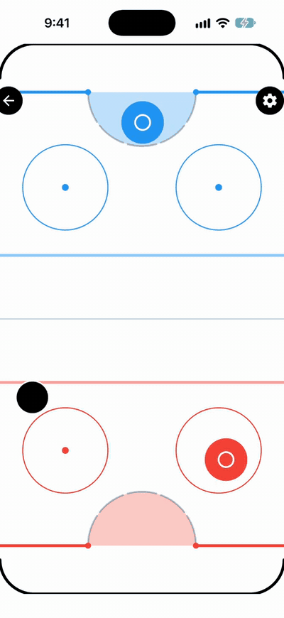

# AirHockey

Fast-paced air hockey on one screen: play the CPU, or sit face-to-face with a friend on one device.

AirHockey is a real-time air hockey game for iOS, Android, and web. Built with Expo, React Native, and React Native Skia, it's part of a family of games built on my open-source `@tastic` game-engine and `@rific` Expo utility packages. App Store and Google Play release in progress.

<p align="center"></p>

## Features

- **Two modes:** One Player against a CPU opponent (Easy, Medium, Hard), or Two Player with both people on the same device, each controlling the paddle in their own half.
- **Pre-match loadout:** a split-screen setup where each seat picks a profile, color, and (on desktop web) a control scheme, then readies up. Shared options cover puck speed (friction), puck size, paddle size, and score to win (3, 5, 7, or 10).
- **Touch, mouse, and keyboard:** drag the paddle with a finger or mouse; on desktop web either seat can switch to WASD, arrow keys, IJKL, or the numpad.
- **Plays in any orientation:** face-to-face in portrait or side-by-side in landscape, with an app-wide Lock Orientation setting.
- **Player profiles:** saved names, colors, and tags per seat. On iOS the roster is shared with my other games through an App Group.
- **Stats and achievements:** per-profile and device-wide records (vs CPU by difficulty, two-player results, goals, shutouts, win and day streaks) and 33 bronze/silver/gold achievements.
- **How-to-play guide:** a short first-run guide, replayable from Settings, whose copy reflects each seat's live control scheme and the current score to win.
- **Settings:** sound, haptics, appearance, Lock Orientation, an iOS option to defer system edge gestures during play, and a manual update check. A match pauses automatically when the app goes to the background.

## Under the hood

- **Physics:** a custom puck integrator (`src/utils/physics.ts`) built on `@tastic/physics` collision primitives (circle vs. rect, circle vs. rounded corner, reflection, friction). Fast pucks are sub-stepped to avoid tunneling, the goal mouth is a one-way door, and the rink's back wall keeps a bounced puck in the pocket. Paddle hits are an infinite-mass collision done by shifting into the paddle's reference frame, so the paddle's velocity (smoothed over a few ticks and capped) carries into the shot. A swept circle check catches swipes that pass clean through the puck between frames.
- **AI opponent:** the CPU picks a target position every tick and feeds it through the same input path a human's drag uses. Each difficulty tunes how far ahead it predicts the puck, how much aim jitter it has, how fast it can move, and how strongly it falls back to its home position. It chases a puck that threatens its goal or a loose puck it can reach first.
- **One coordinate space, rotated:** board geometry, physics, and AI all work in a single portrait-shaped local space. Landscape play rotates the whole board and input tree by ±90°, and touch input is mapped back to board coordinates by inverting that rotation explicitly. That fixes a gesture-handler quirk on web, where rotated views report unrotated coordinates.
- **Split-screen input:** in two-player each seat gets its own gesture zone covering its own half. The loadout uses `@tastic/split-screen` to lay out both players' panels facing each other or side by side.
- **Control schemes:** keyboard seats are driven by a held-key set with its own `requestAnimationFrame` loop for continuous paddle motion, with diagonals normalized. The loadout's pickers use `@tastic/input`'s `assignSeatScheme`, which swaps schemes when they conflict so two seats never share one.
- **Skia rendering across platforms:** the rink, puck, paddles, score arcs, and goal-door flash are drawn with React Native Skia and `@tastic/sprites`. `BoardHost.web.tsx` lazy-loads the board only after CanvasKit (WASM) is ready, while the native `BoardHost.tsx` is a passthrough.
- **State and updates:** Redux Toolkit with redux-persist covers settings, profiles, seat colors, stats, achievements, and guide state, with per-round state left out of persistence. A persist `migrate` recognizes players from the pre-Redux build so they skip the guide. Over-the-air updates ship through `expo-updates` and `@rific/updater`.
- **Tests:** 12 Jest suites with 157 tests covering physics (including containment sweeps over hundreds of steps), the AI, board geometry, the game-state reducer, control schemes, stats and achievements, settings and guide persistence, and profile syncing.

## Built on

| Package | Used for |
| --- | --- |
| [`@tastic/core`](https://github.com/jayrdeaton/React-Native-Game-Core) | Game loop, orientation and rotation handling, background pause, config plugin for the native portrait lock |
| [`@tastic/physics`](https://www.npmjs.com/package/@tastic/physics) | Circle/rect/rounded-corner collision, reflection, friction, goal-wedge geometry |
| [`@tastic/input`](https://www.npmjs.com/package/@tastic/input) | Keyboard scheme resolution and conflict-free seat scheme assignment |
| [`@tastic/split-screen`](https://www.npmjs.com/package/@tastic/split-screen) | Two-player loadout zone layout (face-to-face vs side-by-side) |
| [`@tastic/hud`](https://www.npmjs.com/package/@tastic/hud) | Player setup panels, dropdowns, ready buttons, settings and update dialogs, how-to-play guide, Skia web loader |
| [`@tastic/sprites`](https://www.npmjs.com/package/@tastic/sprites) | Skia board shapes and hockey rink visuals (score arcs, goal-door flash, faceoff circles) |
| [`@tastic/profile`](https://www.npmjs.com/package/@tastic/profile) | Player profiles, picker, roster screen, shared App Group sync |
| [`@tastic/achievements`](https://www.npmjs.com/package/@tastic/achievements) | Tiered achievement catalog, streak tracking, Redux-backed persistence |
| [`@tastic/edge-guard`](https://www.npmjs.com/package/@tastic/edge-guard) | Optional guard against iOS edge system gestures during play |
| [`@rific/core`](https://www.npmjs.com/package/@rific/core) | Redux settings slice factory |
| [`@rific/auto-paper`](https://www.npmjs.com/package/@rific/auto-paper) | React Native Paper theming from seed colors, light/dark appearance |
| [`@rific/feedback-press`](https://www.npmjs.com/package/@rific/feedback-press) | Buttons with haptic and sound feedback, vibration, game sounds |
| [`@rific/toaster`](https://www.npmjs.com/package/@rific/toaster) | Toast notifications (achievement unlocks, update errors) |
| [`@rific/splash-gate`](https://www.npmjs.com/package/@rific/splash-gate) | Keeps the splash screen up until profiles have loaded |
| [`@rific/updater`](https://www.npmjs.com/package/@rific/updater) | OTA update checks and the build/update scripts |
| [`@rific/focus-chain`](https://www.npmjs.com/package/@rific/focus-chain) | Peer dependency of `@tastic/profile` for form focus |

## Getting started

```bash
npm install
npm run ios        # or: npm run android / npm start (web)
```

The app uses native code that Expo Go doesn't include (the `@tastic/core` and `@tastic/edge-guard` config plugins and `@tastic/profile`'s native iOS shared-roster module), so iOS and Android run as a development build (`expo-dev-client`). `npm run ios` and `npm run android` build it locally. `npm install` also runs `setup-skia-web`, which sets up CanvasKit for the web target.

### Checks

```bash
npm run verify     # lint (expo lint) + Jest + typecheck (tsc)
```

## Project layout

```
src/
  app/          expo-router screens: home, loadout, game, profiles, achievements
  components/   board rendering, touch and keyboard input layers, dialogs, theme, guide host
  constants/    game tuning, achievement catalog, guide steps, fonts, release info
  hooks/        game state reducer and loop, AI opponent, profiles, stats, settings, sound
  redux/        redux-persist store and slices (settings, profiles, seat colors, achievements, guide, live play)
  types/        shared TypeScript types
  utils/        physics, board geometry, AI, control schemes, stats engine and validation
  __tests__/    Jest suites
  __mocks__/    manual mocks for native and Expo modules
```

## License

The code is released under the MIT License, see [LICENSE](LICENSE).

The game's name, logo, and icons, and the original artwork and audio in this repository, are not covered by that license and remain all rights reserved. If you fork it, please give your version its own name and look.
